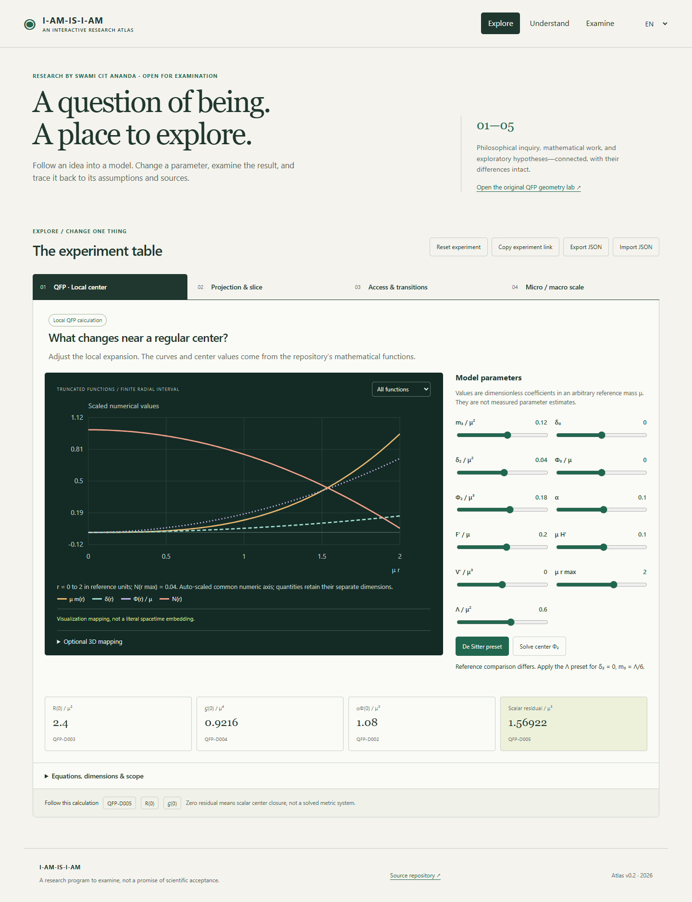
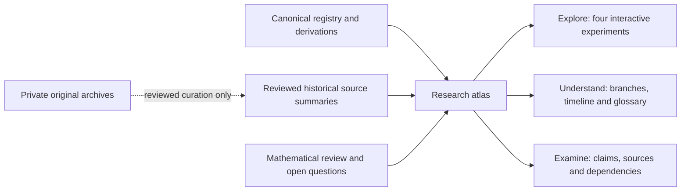

# I-AM-IS-I-AM

Canonical research repository for QFP, a developing theoretical research framework. QFP is not established physics. This repository is designed to preserve definitions and intellectual history while subjecting mathematical models and physical claims to explicit attempts at falsification.

The **interactive research atlas** gives this record three entry points: **Explore** four interactive experiments, **Understand** the research branches through a timeline and glossary, and **Examine** claims, sources and dependencies. It connects the current canonical work to historical drafts without promoting a diagram, analogy or saved conversation into evidence of physical truth.

Research program: **Swami CIT Ananda / `chatgptopenaiagi`**. Individual sources retain their own provenance; this credit does not assign unknown authors, speaker roles or generating models to recovered documents.

**[Open the research atlas](https://chatgptopenaiagi.github.io/I-AM-IS-I-AM/)** · [Deployment status](https://github.com/chatgptopenaiagi/I-AM-IS-I-AM/actions/workflows/qfp-pages.yml)



[Research atlas](01_THEORY/Research_Atlas.md) · [Source register](10_REFERENCES/Atlas_Sources.md) · [Corpus coverage](10_REFERENCES/Corpus_Coverage.md) · [Mathematical review](12_VALIDATION/Atlas_Mathematical_Review.md) · [Verification](docs/VERIFICATION.md) · [Contributing](docs/CONTRIBUTING.md)

## Run the atlas locally

From the repository root, with Node.js and npm available:

```sh
npm ci
npm test
npm run build
npm run serve
```

Open **[http://127.0.0.1:4173/I-AM-IS-I-AM/](http://127.0.0.1:4173/I-AM-IS-I-AM/)** after the local server starts. The build writes `dist/`; the local preview serves the browser application sources in [`WEB/qfp-lab/`](WEB/qfp-lab/) by default. Set `ATLAS_ROOT=dist` to preview the built bundle instead. The original geometry laboratory is retained as [`geometry.html`](WEB/qfp-lab/geometry.html). A public deployment is not claimed by these local instructions.

The atlas separates four interactive modules: the canonical QFP local-center model, continuum/projection exploration, access constraints, and micro/macro scale exploration. The module descriptions state which elements are definitions, conditional derivations, historical proposals or illustrations. A control changing a visual does not establish a physical mechanism.



## Archive coverage and privacy

The inspected corpus currently supplies **no original ChatGPT conversation export and no independently timestamped original messages**. The saved-document candidates and owner-reported historical leads are described in the [coverage record](10_REFERENCES/Corpus_Coverage.md). File dates are not message dates, and an unsuccessful bounded search is not evidence that an archive does not exist elsewhere.

An external private source index records hashes of six saved extraction/metadata files. Those hashes identify the stored extraction JSON bytes, not the original cloud files or missing conversation transcripts. The private index and full extracts are not part of the website.

[`archive_tools/`](archive_tools/README.md) provides a local-only importer for explicitly supplied ChatGPT JSON/ZIP exports. It retains source bytes, all conversation branches, IDs, roles, actual timestamp values, metadata, attachment references, and duplicate/conflicting versions. Unknown language, model and authorship remain unknown. Two-year/three-year and keyword views index the full corpus rather than filtering it away. **Private imports must remain outside this repository and the public website.** Only reviewed, project-relevant curation belongs in the atlas.

## Scientific status

Important foundational objects are labeled by type: `DEFINITION`, `ASSUMPTION`, `ANSATZ`, `SCHEMA`, `NOTATION`, or `WORKING MODEL`. Scientific claims about validity or support use one epistemic status:

`ESTABLISHED`, `DERIVED`, `HYPOTHESIS`, `CONJECTURE`, `SPECULATIVE`, `NUMERICAL RESULT`, `FALSIFIED`, or `SUPERSEDED`.

These labels describe epistemic status; they are not decorative. In particular, mathematical consistency and numerical output do not constitute empirical confirmation.

## Current research schemas

**Object type: SCHEMA.** The Continuum-Projection Ontology is currently represented by

```text
C -> Sigma
C_4D -> Sigma_3D
Observer in Sigma
```

These are research schemas. No physical projection mechanism is presently claimed to have been demonstrated.

**Object type: ASSUMPTION.** The coupling functions `F(Phi)` and `H(Phi)` are kept independent unless a derivation establishes a relation.

**Object type: WORKING MODEL.** The scalar-tensor-Gauss-Bonnet gravitational investigation currently uses the action

```text
S = integral d^4x sqrt(-g) [
    F(Phi) R
    - 1/2 grad(Phi).grad(Phi)
    - V(Phi)
    + alpha H(Phi) G
]
```

**Object type: ANSATZ.** The static spherical metric is

```text
ds^2 = -e^(2 delta(r)) N(r) dt^2 + dr^2 / N(r) + r^2 dOmega^2
```

**Object type: DEFINITION.** The mass function is defined through

```text
N(r) = 1 - 2 m(r)/r
```

**Object type: ANSATZ.** The regular-center expansion under investigation is

```text
m(r) = m3 r^3 + O(r^5)
delta(r) = delta0 + delta2 r^2 + O(r^4)
Phi(r) = Phi0 + Phi2 r^2 + O(r^4)
```

**Status: DERIVED.** Within the adopted static spherical regular-center expansion and canonical curvature convention, the Gauss-Bonnet central expression is

```text
G(0) = 96 m3 (m3 - delta2)
```

The associated working de Sitter substitution is

```text
delta2 = 0
m3 = Lambda/6
G(0) = 8 Lambda^2 / 3
```

Provenance: `02_MATHEMATICS/derivations/Regular_Center_Scalar_Reduction.md`, with the independent validation record in `12_VALIDATION/regularity/Scalar_Regular_Center_Test.md`. The substitution is algebraically consistent with the derived central expression and supplies a de Sitter check; it does not extend the result beyond the adopted local ansatz and curvature convention.

**Status: DERIVED.**

**Equation qualifier: EXACT local regular-center consequence of the derived covariant scalar equation, within the protected working model, canonical conventions, and regular-center ansatz.** The current central scalar relation is

```text
6 Phi2
- V'(Phi0)
+ (24 m3 - 12 delta2) F'(Phi0)
+ 96 alpha m3 (m3 - delta2) H'(Phi0)
= 0
```

Provenance: `02_MATHEMATICS/derivations/Regular_Center_Scalar_Reduction.md`, independently checked in `12_VALIDATION/regularity/Scalar_Regular_Center_Test.md`. This is a local result within the stated assumptions; it does not establish a global solution, global regularity, stability, observational validity, or experimental support.

## Repository map

- `00_FOUNDATION/`: definitions, scope, assumptions, and governance-adjacent scientific foundations.
- `01_THEORY/`: conceptual and physical theory development.
- `02_MATHEMATICS/`: notation, definitions, derivations, and boundary conditions.
- `03_QFP_MODELS/`: explicit QFP model families.
- `04_HYPOTHESES/`: testable hypotheses, conjectures, predictions, and failure criteria.
- `05_SIMULATIONS/`: computational studies and generated numerical results.
- `06_EXPERIMENTS/`: proposed experiments, measurements, and observational tests.
- `07_FIGURES/`: diagrams and reproducible quantitative plots.
- `08_PAPERS/`: manuscripts and supplementary material.
- `09_PORTFOLIO/`: cross-project indexes and research-program views.
- `10_REFERENCES/`: verified bibliographic material and reference notes.
- `11_RESEARCH_LOG/`: dated records of major conceptual and mathematical changes.
- `12_VALIDATION/`: attempts to find contradictions and falsify models.
- `SOFTWARE/`: reusable scientific software and its tests.
- `WEB/qfp-lab/`: interactive atlas, curated display data, visual modules, browser tests and retained geometry laboratory.
- `archive_tools/`: private archive importer and synthetic tests; no real exports belong here.
- `docs/`: contribution workflow and [repository inventory](docs/REPOSITORY-INVENTORY.md).
- `ARCHIVE/`: failed, superseded, and historically useful approaches.

See [AGENTS.md](AGENTS.md) for the binding repository governance and contribution rules.

## QFP Interactive Geometry Laboratory

The retained static laboratory in [`WEB/qfp-lab/geometry.html`](WEB/qfp-lab/geometry.html) interactively visualizes the independently derived local regular-center model. It is a visualization and mathematical consistency companion, not experimental validation of QFP and not a literal spacetime embedding. The atlas provides the surrounding source, branch and review context.

## Validation principle

Validation does not aim to prove QFP correct. It asks whether a claim survives mathematical, dimensional, limiting-case, regularity, asymptotic, numerical, observational, and falsifiability tests.

## Current stage

The repository remains in its foundation and formalization stage. Recorded scalar/local-center derivations and their limits are linked above. The [current mathematical review](12_VALIDATION/Atlas_Mathematical_Review.md) and separate [metric bulk-variation draft](12_VALIDATION/Atlas_Metric_Bulk_Variation_Draft.md) distinguish completed checks from work still requiring independent review. Further milestones include a complete metric reduction, a well-posed boundary problem, global and stability analysis, and explicit observational failure criteria.

See the [2026-11-11 research log](11_RESEARCH_LOG/2026/2026-11-11_interactive-research-atlas.md) for this atlas's scope, validation record and unresolved issues.
