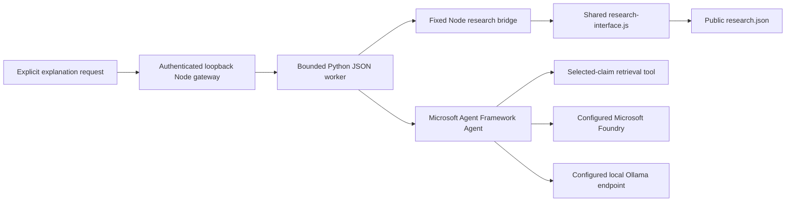

# Microsoft Agent Framework research explanation boundary

This integration uses the real Microsoft Agent Framework Python SDK. It retrieves a selected public research record through the same JavaScript adapter used by the atlas and can ask an explicitly configured **Microsoft Foundry** deployment or **local Ollama endpoint** to explain it. It does not change the scientific record.

As observed on **2026-11-11**, the project SDK is installed and the offline tests pass. The provider state is **NOT CONFIGURED**. No live model request, Azure token acquisition, model download, or existing server startup was performed. The synthetic model in the tests is a test double, not evidence of AI availability.

## Local discovery and installed components

The bounded discovery reused the workstation inventory and inspected named package/CLI locations. Existing .NET SDKs include 5.0.416, 8.0.428, 10.0.401, 10.0.403, and 11.0.100-preview.7.26381.103. There was no matching Agent Framework/Semantic Kernel/AutoGen/Azure Python package in the inventory subset queried, and no matching Microsoft agent/Azure NuGet directory in the named cache check. This is **not** a claim that the workstation contains no other SDK installation.

A portable Ollama executable is present at `C:\ollama-windows-amd64\ollama.exe`; it was not started or contacted. No configured Foundry/Ollama endpoint/model, Azure service-principal environment variables, or Azure CLI executable was detected in the checked locations. Credential inspection recorded **presence booleans only**; it did not read token caches or secret files. The sanitized evidence is [discovery.json](../services/microsoft/discovery.json).

Only this isolated project environment was created: `services/microsoft/.venv`, using the existing Python **3.14.7**. No Windows PATH, global Python environment, Codex configuration, or existing model installation was changed.

| Direct package | Tested version |
| --- | --- |
| `agent-framework-core` | 1.25.0 |
| `agent-framework-foundry` | 1.16.1 |
| `agent-framework-ollama` | 1.0.0b261106 (prerelease) |
| `azure-identity` | 1.27.0 |

The Foundry provider transitively installs `agent-framework-openai` and the OpenAI client library as part of Microsoft's SDK implementation. **This application does not instantiate an OpenAI Platform provider, accept an OpenAI API key, or target `api.openai.com`.** Foundry requests use a Microsoft project endpoint and Azure identity. The tested transitive versions, including `azure-ai-projects==2.9.0`, are recorded in [requirements-lock.txt](../services/microsoft/requirements-lock.txt).

## One HTTP gateway, one bounded worker

The Node gateway owns the browser-facing API and its authentication/origin policy. It invokes [worker.py](../services/microsoft/worker.py) as a one-request subprocess with `shell:false`. Python does not start another web server.



The bridge has exactly one operation, `get_claim`, and a fixed source file. It imports `makeResearchModel` and `getResearchObject` from `WEB/qfp-lab/js/research-interface.js`; Python does **not** duplicate the canonical registry or its adapter. The selected claim retains all five scientific axes and its original source metadata. The response includes the adapter's schema version and source fingerprint plus SHA-256 of the exact public JSON bytes. A fingerprint/hash identifies the observed source; it does not authenticate a scientific claim or certify correctness.

The agent tool can return only the selected record and that record's public source descriptors. Other claim IDs return `OUT_OF_SCOPE`. Paths, shell commands, arbitrary URLs, private archives, browsing, database access, and computation are not tools. Agent calls are limited to three tool iterations/calls and a 35-second model timeout. The fixed bridge has an eight-second subprocess limit. The gateway should allow at most 45 seconds for the full explanation worker and eight seconds for status.

## Worker protocol

Launch from the repository root, using an absolute executable/script path in the gateway:

```powershell
& services/microsoft/.venv/Scripts/python.exe -B services/microsoft/worker.py
```

On POSIX the interpreter is `.venv/bin/python`. Send one UTF-8 JSON object on stdin and close stdin. Read one JSON object from stdout. The input limit is 32 KiB; questions are limited to 2,000 characters. Unknown fields, unsupported operations, invalid IDs and unrecognized languages are rejected. Do not expose worker stderr to browser clients.

```json
{"operation":"status"}
```

```json
{"operation":"guide","claim_id":"QFP-S001","language":"en"}
```

```json
{"operation":"explain","claim_id":"QFP-S001","question":"What is still unspecified in this schema?","language":"en","approved":true}
```

Only `en` and `ro` are supported. `approved:true` is required for an explanation request and must be supplied by the gateway after the user's explicit action. Startup/status/guide requests never instantiate a provider or acquire a credential. The gateway's public API may expose `GET /api/capabilities` and `POST /api/explain`; this private worker protocol is independent of HTTP route naming.

Successful model output has this shape:

```json
{
  "status": "AI_RESPONSE",
  "answer": "Model-generated explanation, always unverified AI output",
  "claim_id": "QFP-S001",
  "source_revision": "atlas-fnv1a32:<observed fingerprint>",
  "source_sha256": "<public source bytes SHA-256>",
  "source_ids": ["<actual selected source ID>"],
  "basis": ["RETRIEVED_SOURCE", "AI_REASONING"],
  "provider": "foundry",
  "model": "<explicitly configured deployment>",
  "computation_executed": false,
  "verification": "UNVERIFIED_AI_OUTPUT"
}
```

`source_ids` comes from the retrieved record, not from model-generated citations. The model's wording and any citations it invents remain unverified. Render the answer as text, never trusted HTML. `provider_contacted` is false for status/guide/no-consent, true after an actual returned provider response, and null on failure/timeout where successful contact cannot be established.

| Status | Meaning |
| --- | --- |
| `NOT CONFIGURED` | Provider, endpoint/model, or explicit Azure authentication is missing. `answer` is empty for explanation requests. |
| `CONFIGURED_UNTESTED` | Configuration shape and required package presence are valid; no provider request was made by status. |
| `SDK NOT INSTALLED` | Required project packages are unavailable in this interpreter. |
| `INVALID CONFIGURATION` | The provider, endpoint, model name or authentication mode fails the boundary. |
| `CONSENT_REQUIRED` | No model call was made because `approved:true` was absent. |
| `OFFLINE_GUIDE` | A deterministic source summary, explicitly labelled as having no AI model. |
| `AI_RESPONSE` | A model returned text; this is not scientific verification. |
| `PROVIDER_ERROR` / `PROVIDER_TIMEOUT` | No answer is substituted; provider exception text is suppressed. |

## Configure an existing provider explicitly

No `.env` file is automatically opened. Configuration is read from the worker process environment. Secrets are not accepted through browser JSON, included in status responses, or written by this service. Do not commit credentials.

| Variable | Meaning |
| --- | --- |
| `TRIAD_MICROSOFT_PROVIDER` | Explicit `foundry` or `ollama`; absent means NOT CONFIGURED. |
| `TRIAD_MICROSOFT_ENDPOINT` | Explicit endpoint; may fall back to `FOUNDRY_PROJECT_ENDPOINT` or `OLLAMA_HOST`. |
| `TRIAD_MICROSOFT_MODEL` | Existing deployment/model tag; may fall back to `FOUNDRY_MODEL` or `OLLAMA_MODEL`. No model is selected automatically. |
| `TRIAD_MICROSOFT_AUTH` | Foundry only: `environment` (default) or `azure-cli`. |

Foundry accepts only HTTPS Microsoft public-cloud project endpoints of the form `https://<resource>.services.ai.azure.com/api/projects/<project>`, without embedded credentials, query strings, or fragments. `environment` uses the explicitly configured `AZURE_TENANT_ID`, `AZURE_CLIENT_ID`, and `AZURE_CLIENT_SECRET` through `ClientSecretCredential`, with the Azure public-cloud authority pinned. `azure-cli` uses `AzureCliCredential`; Azure CLI must already be on PATH and authenticated by the operator. Neither authentication mode was configured or verified here. Sovereign-cloud endpoints and other credential modes are intentionally unsupported by this boundary. Foundry response storage is requested off (`store:false`); provider retention and organizational policies still apply.

Ollama accepts only an HTTP loopback endpoint (`127.0.0.1`, `::1`, or `localhost`), with proxies and redirects disabled. It uses the native Microsoft `OllamaChatClient`, not an OpenAI-compatible fallback. The service must already be running and the selected model must already be available. This code does not start it, download models, enumerate models, or assume that an executable proves a working server. A loopback endpoint alone does not prove the server's model runs entirely locally; the operator must choose a local model and understand the existing server configuration. Foundry Local runtime management is not implemented.

An explicit AI request transmits the selected **public** claim/source descriptors, the question, and language to the configured provider. Private export/import corpora and credentials are excluded from the research context. Do not place private material in a question you intend to send to a remote provider.

## Epistemic separation

These provenance categories are separate from the canonical `object_type` and `epistemic_status` fields:

| Category | Permitted meaning |
| --- | --- |
| `RETRIEVED_SOURCE` | A record actually read from the shared source adapter; no new verification implied. |
| `MATHEMATICAL_DERIVATION` | An inspectable derivation in a source, retaining assumptions/domain; not an automatic label for fluent model text. |
| `EXECUTED_COMPUTATION` | Requires a recorded computation. This explanation worker never emits this as its own basis and always reports `computation_executed:false`. |
| `PHILOSOPHICAL_INTERPRETATION` | An interpretive statement, not physical evidence. |
| `AI_REASONING` | Model-generated synthesis; unverified and subject to source review. |
| `UNVERIFIED_SPECULATION` | Unsupported possibilities; no empirical or derivational promotion. |

The prompt asks the model to use these labels accurately, but a model's labels are themselves unverified output. The trusted response envelope classifies the entire generated answer as `AI_REASONING`. A retrieved record marked `DERIVED` retains that source status without turning the model's explanation into a newly checked derivation. `QFP-S001` remains a `SCHEMA` with no assigned epistemic status or demonstrated physical projection mechanism. The offline guide labels the curated atlas statement, marks editorial paraphrases, preserves recorded attribution, and separately shows exact `original_wording` only when that field is present. It does not present an editorial summary as an original quotation, answer arbitrary questions, or impersonate an LLM.

## Reproduce setup and tests

Install only inside an explicitly created project environment when setup is needed:

```powershell
& C:\Python314\python.exe -m venv services/microsoft/.venv
& services/microsoft/.venv/Scripts/python.exe -m pip install -r services/microsoft/requirements-lock.txt
& services/microsoft/.venv/Scripts/python.exe -m pip check
& services/microsoft/.venv/Scripts/python.exe -B -m unittest discover -s services/microsoft -p test_worker.py -v
'{"operation":"status"}' | & services/microsoft/.venv/Scripts/python.exe -B services/microsoft/worker.py
```

On **2026-11-11**, **17/17 offline tests passed** and `pip check` reported no broken requirements. Tests cover actual Foundry/Ollama SDK construction with socket connections forbidden; the actual Agent/tool loop with a labelled synthetic model; denial of retrieval outside the selected claim; source metadata fidelity; provider/endpoint rejection; absent configuration and consent; deterministic English/Romanian guides; editorial-versus-original wording and attribution; bounded input; unknown records; and redaction of provider errors. No paid API call or live provider inference was part of these tests. Model tool support, available deployment permissions, response quality, and live network behavior remain unverified.

Current official references checked on 2026-11-11: [Microsoft Agent Framework overview](https://learn.microsoft.com/en-us/agent-framework/overview/agent-framework-overview), [provider model](https://learn.microsoft.com/en-us/agent-framework/user-guide/agents/agent-types), [Microsoft Foundry package](https://github.com/microsoft/agent-framework/tree/main/python/packages/foundry), [Microsoft Ollama package](https://github.com/microsoft/agent-framework/tree/main/python/packages/ollama). The implementation was checked against the installed pinned SDK signatures; older examples using `ChatAgent`, `AzureAIClient`, or `model_id` do not describe this pinned integration.
