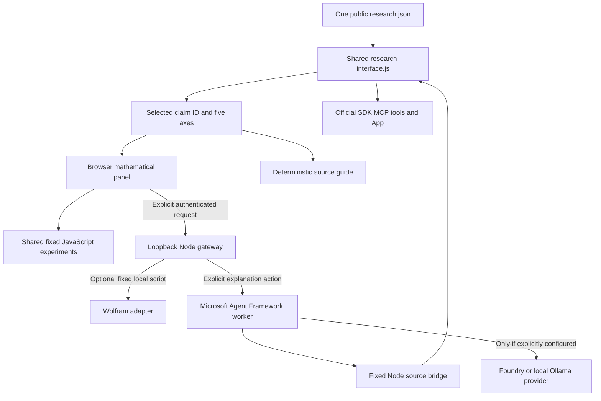

# TriadResearchEngine

TriadResearchEngine adds three coordinated research views to the existing I-AM-IS-I-AM atlas: mathematical exploration, source-grounded explanation, and an MCP interface. All three use the same selected research-object ID and the same public data adapter. It is research software, not a declaration that QFP or the philosophical program is established physics.

Open [`WEB/qfp-lab/triad.html`](../WEB/qfp-lab/triad.html) through the local preview server. The existing atlas and geometry laboratory remain separate accessible routes. Six navigation topics—projection, observer/access, scale, QFP/geometry, time/causality, and identity—organize the existing records; they do not create six new scientific classifications or replace the source's five branches.

## Shared scientific record

[`research.json`](../WEB/qfp-lab/data/research.json) remains the curated source. [`research-interface.js`](../WEB/qfp-lab/js/research-interface.js) creates one deterministic model that preserves all **34 research IDs**, including **13 canonical records**, and every source claim field. The five protocol axes stay separate:

1. Scientific object type.
2. Epistemic status.
3. Domain and scope.
4. Explicit dependencies.
5. Validation and computational metadata.

The model also retains attribution, evidence, units, limitations, editorial/paraphrase flags, dates and the `SCHEMATIC` qualifier where present. A selected object's full JSON can be inspected and exported. Formal dependencies are distinct from interpretive, analogy and historical relationships. Reusing a record in an interface does not promote its status.

`makeResearchModel(atlasData)` adapts the source; `getResearchObject(model, id)` retrieves a record; `validateResearchModel(model, expectedModel)` can compare an imported model against the trusted bundled model. The deterministic `source_revision` is an FNV-1a32 change indicator, not a cryptographic signature, authorship certificate or proof of correctness. Structure-only validation cannot authenticate arbitrary replacement source data. The Microsoft bridge additionally records SHA-256 of the exact public source bytes without maintaining a second registry.



Static GitHub Pages can serve the browser files. It does not execute Node, Python, Wolfram, Microsoft providers or the MCP server. The gateway and services are optional local processes with separate setup and verification requirements.

## What actually computes

[`research-experiments.js`](../WEB/qfp-lab/js/research-experiments.js) defines four exact bindings. Descriptors provide the authoritative numeric parameter schema, defaults, dependencies, methods and limitations. Missing parameters receive defaults. Service boundaries reject unknown keys, unsupported pairings, code-like strings, nonfinite values and out-of-range values. Browser controls can normalize a user's input into their displayed range before submitting the explicit numeric request.

| Experiment | Research object | Actual calculation and boundary |
| --- | --- | --- |
| Ball projection | `ATLAS-BALL-PROJECTION` | The unit ball's full disk image is compared with a height-dependent disk, point or empty slice. No physical projection mechanism is demonstrated. |
| Integer access | `ATLAS-INTEGER-ACCESS` | `T(n)=n+1` and an independent finite viewing window. Browser bounds do not enumerate or restrict the mathematical integers. |
| Log scale | `ATLAS-LOG-SCALE` | Positive lengths, logarithmic coordinates and the selected reciprocal identity. `q=0` is the reference length, not zero length or zero kelvin. |
| QFP local center | `QFP-D005` | Protected conditional center identities, scalar residual, reference-curvature comparison and a finite truncated-polynomial check. No global metric solution, stability or empirical agreement is computed. |

Other objects remain inspectable without acquiring a fabricated experiment. In particular, lack of an attached numerical implementation does not make a canonical mathematical derivation philosophical or invalidate it.

A run records schema/source revision, actual engine, normalized inputs, method, functions, dependencies, assumptions, definitions, units, precision, output, checks and limitations. The JavaScript engine executes on selection/parameter change and can be explicitly rerun. A displayed source's prior validation metadata is not a new test execution. Algebraic checks and comparison tolerances are documented in [TRIAD-WOLFRAM.md](TRIAD-WOLFRAM.md); they are not observational uncertainty or convergence estimates.

QFP coefficients use an arbitrary reference mass `mu` as in the [mathematical review](../12_VALIDATION/Atlas_Mathematical_Review.md). A zero scalar residual satisfies that scalar center relation only. When truncated `N(r)` reaches/crosses zero in the displayed interval, local continuation is not established and the zero is not a proven horizon. The `Lambda=0` and negative-`Lambda` reference cases are Minkowski and anti-de Sitter-type, respectively. Full field equations, global boundary conditions and physical tests remain separate work.

## Reproduction and explanation

State links contain the selected topic/object, language and bounded parameters. They contain no gateway token or provider credentials. The JSON experiment export contains the actual deterministic JavaScript result. Import reruns the same experiment against the current source and requires matching schema, source revision, engine, inputs, process metadata, outputs, validation and limitations. Edited or mismatched evidence is rejected.

**Import currently requires exact JSON-value equality.** This is deliberately stricter than a numerical tolerance check: harmless final-bit differences in floating-point elementary functions across browser/runtime implementations may reject an otherwise equivalent result. Such rejection is not mathematical falsification. Wolfram outputs cannot impersonate a browser result. A model/object export is a source record, distinct from an executed-experiment export.

The browser's local guide deterministically presents the selected public record; it is not an LLM. An optional Microsoft explanation sends the selected public claim/source descriptors, question and language only after an explicit user action. Provider credentials remain in the service environment. Generated text is labeled unverified AI reasoning; it does not become an executed computation, newly verified proof or source-authenticated quotation. Editorial summaries must retain their paraphrase attribution instead of being treated as recovered original wording.

Provider configuration and operation are separate. `CONFIGURED_UNTESTED` indicates that configuration/package checks passed, not that an endpoint/model responded. A real returned model response establishes that request's execution, not the answer's scientific validity. A discovered Wolfram executable similarly remains `DETECTED_NOT_VERIFIED` until an actual bounded run. Missing or failed services do not receive substitute answers represented as successful remote computation.

## Local use and service documentation

From the repository root, the existing commands build and serve the public interface:

```text
npm run build
npm run serve
```

The source preview route is `http://127.0.0.1:4173/I-AM-IS-I-AM/triad.html`. To inspect the built bundle, set the preview process's `ATLAS_ROOT` to `dist`. These addresses describe local preview behavior, not a public deployment result.

The optional services have their own bounded setup and documentation:

- [MCP server, MCP App and authenticated loopback gateway](TRIAD-MCP.md): eleven read-only tools, real official SDK transports, input schemas and a UI resource. No ChatGPT registration or reachable remote HTTPS deployment is implied.
- [Microsoft Agent Framework](TRIAD-MICROSOFT.md): isolated project SDK, fixed source bridge, deterministic guide and explicitly configured Foundry/Ollama explanation boundary. A portable Ollama executable alone does not prove a running service/model.
- [Wolfram and shared experiments](TRIAD-WOLFRAM.md): fixed numeric JSON scripts, optional interactive/static figures, discovery coverage and actual-versus-synthetic checks. No Wolfram runtime was found within the documented bounds.
- [Triad verification record](TRIAD-VERIFICATION.md): completed local suites, 26/26 built-browser tests, hosted CI, verified static deployment and remaining optional-runtime boundaries.

The browser connects only through an explicit gateway form. The loopback gateway requires its local bearer token and allowed origin/Host policy. Private corpus files and credentials are not part of the research adapter or publication artifact. The service package directories and isolated Python environment are not copied into the static site.

The [public Triad Lab](https://chatgptopenaiagi.github.io/I-AM-IS-I-AM/triad.html) is deployed and was verified against merge commit `5c89e71` on 2026-11-11. Local and hosted validation include JavaScript computation, the built-browser suite and real local MCP SDK integration; the Microsoft SDK passed offline/synthetic tests. No live Microsoft provider, Wolfram calculation or ChatGPT registration has been verified.
